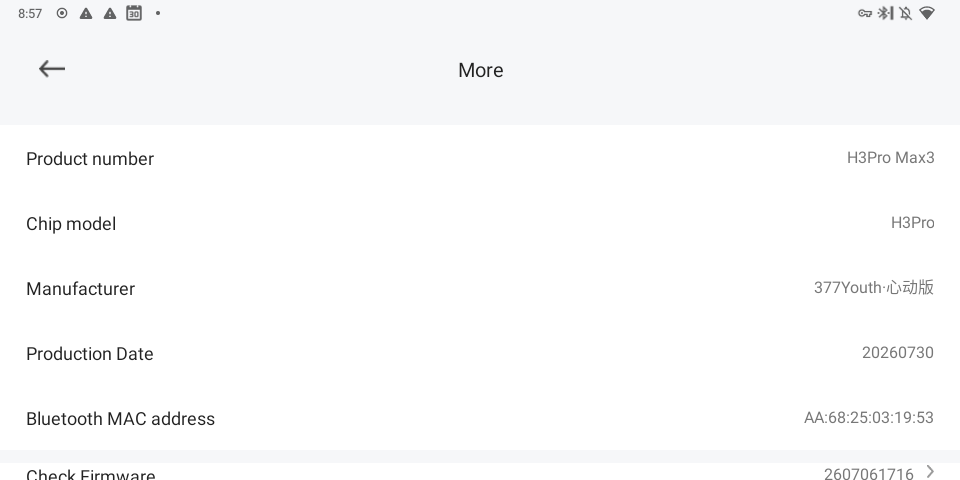

# 01 · The device: H3Pro Max3

## Identity (as reported by the buds to StarFun)



| Field | Value |
|---|---|
| Product number | `H3Pro Max3` |
| Chip model | `H3Pro` |
| Manufacturer | `377Youth·心动版` |
| Production date | `20260730` |
| Bluetooth MAC | `AA:68:25:03:19:53` |
| Firmware version | `2607061716` (build stamp = 2026-07-06 17:16) |

The replica community's naming: "V5.4 = Huilian 377", "V7 = Huilian 377H3". The buds' own
`H3Pro` / `377Youth` strings match the 377H3 generation.

## The exact OTA request the app makes

Tapping **Check Firmware** in StarFun 2.0.7.016 produced (from `logcat`):

```
GET https://ota.starfun.fun/api/v1/_/appversions/update
      ?package=h3promax3
      &version=2607061716
      &deviceid=AA:68:25:03:19:53
Authorization: <tenant JWT>

→ HTTP 204 No Content
```

* `package` is the product name lower-cased with spaces removed. That's the server key.
* **204 means "no update for you"**, not an auth failure: replaying the request with our own
  token at other `version` values (including `0`) also returns 204, while known packages such as
  `a10` return JSON with a download URL.
* The full catalog ([03](03-ota-catalog.md)) contains no `h3promax3` entry at all, and its newest
  image (June 2025) is older than the buds' factory firmware (July 2026). The server simply has
  nothing for this product yet.

## How this was captured (repeatable procedure)

The buds were paired to an **Amazon Echo Show 5 (2nd gen) running LineageOS 18.1 / Android 11**
that is on the owner's Tailscale network. From a Devin VM on the same tailnet:

1. `adb pair <ip>:<pair-port> <code>` then `adb connect <ip>:<port>` (Wireless debugging).
   Note: requesting `adb root` restarts adbd and changes the port, so don't.
2. Install StarFun **2.0.7.016** (`adb install -r -d`) — 2.0.7.017 refuses these buds with
   "This device is not supported, please replace it" ([02](02-starfun-app.md)).
3. Put the buds in / power on so they auto-connect to the Echo Show.
4. `adb logcat` while tapping Check Firmware; the OTA URL is printed in clear.

Useful side facts: package name `com.fun.app`; the app's stored `user_token` JWTs
have issuer `https://dev.izhiju.cn/api` (a backend hostname distinct from `ota.starfun.fun`);
device model/firmware are not cached in app storage — they are read live over Bluetooth
(`C0 04` "product model" command, stored transiently as `proModel_04`).

## What this means for getting firmware

| Route | State |
|---|---|
| Wait for StarFun to publish an `h3promax3` OTA | Not needed for a base image any more: we already have one, read off the buds ([16](16-live-flash-dump.md)). A published `.up` would still be nice for its header chip-name field. `tools/pull_ota.py h3promax3 2607061716` checks. |
| Shenju OTA host `ota.shenjugroup.com` | Real second channel, needs no login — but keyed by a per-product `firmware_id` and has **no list endpoint**; the only IDs in the app map to a smartwatch. Dead end without an ID. |
| Reseller-specific host/account (377Youth / 心动版) | None found. |
| Read flash off the buds | **Done.** `C0 83` reads 200 bytes at a time; looping it over the app's authenticated socket pulled the whole 1 MiB at about 1.1 KB/s (`tools/flashdump.py`, [16](16-live-flash-dump.md)). The physical UART boot-ROM via the case pins is still untested, see [12](12-shenju-flasher.md). |
