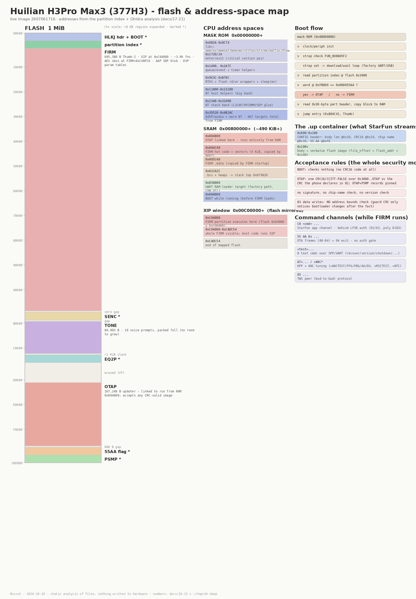

# 21 · Night-shift deep pass: ROM surface, AES, EQ2P answers, catalog sweep

The diagram above (generated by [`tools/flashmap.py`](../tools/flashmap.py) from the live
image's real numbers) shows the whole 1 MiB flash layout, the three CPU address spaces
(mask ROM / SRAM / XIP window), the boot flow, the `.up` container wrap, the acceptance
rules and the command channels on one page.

Second-pass analysis done overnight with Ghidra 12.2 (headless, PyGhidra scripts) on top of
docs [17](17-firmware-internals.md)/[18](18-firm-walkthrough.md). Everything here is static
analysis of files already in the repo or inside the StarFun APK; nothing touched hardware.
Raw outputs live in `~/tmp/oh-dump/` on the analysis box; the durable results are below and
in `data/analysis/night-shift-findings.md`.

## What's new here vs. 17/18

1. The mask ROM is a **library**, not 4 functions.
2. FIRM ships a **software AES** (adverts only, the image integrity model in 05 still holds).
3. The EQ2P "pages 51-57" open question is answered for this build.
4. The StarFun native `encryptData` is confirmed to be the same LFSR the repo already
   implements - open item closed.
5. The Shenju `COM.dll` UART boot-ROM frame format is decoded (first time).
6. The APK's `zero_ota.bin` is a full service firmware with a CLI.
7. A scripted sweep of all 24 catalog images + the OpenPod dump (new tool `tools/upparts.py`).

## The mask ROM surface: 467 call targets

A direct-BL sweep (capstone, Thumb-2) over FIRM/OTAP/BOOT plus the decompiled-C
`func_0x…`/`thunk_EXT_FUN_…` references gives **467 distinct mask-ROM call targets** from
FIRM alone. Docs 17/18 document ~10 of them. The heavy hitters:

| ROM addr | calls | what |
|---|---|---|
| `0xB6D8` / `0xB6C4` | 278 / 218 | enter / exit critical section (the documented pair) |
| `0xB2A` / `0xBAA` / `0xC54` | 235 / 231 / 163 | memcpy / memset / memcmp |
| `0xB78C` | 110 | sleep N ms |
| `0x4B29C` | 121 | BT stack helper (A2DP/RF glue) |
| `0x1A90` | 90 | queue/event post |
| `0x11044` / `0x110C0` | 80 / 52 | BT host helpers |
| `0x48268` | 63 | flash helper |
| `0xC70` / `0xC74` | 57 / 56 | malloc / free |
| `0x2A7C` | 76 | timer/queue helper |
| `0xB534` / `0xB514` | 60 / 55 | flash read/write wrappers (used by `FUN_0080576c`) |
| `0x9E3C` | 58 | RTOS helper (called from task creation) |
| `0x404132` | 42 | audio/DSP helper |
| `0xC0DC` / `0xC096` | 25 / 19 | printf family (debug prints) |

The `0x11000`-`0x31000` band is called from the BT stack code: large parts of the vendor BT
stack live in mask ROM and only the glue is in FIRM. For CFW that's good news - patched code
can call the same ROM services FIRM does. Full table: `data/analysis/night-shift-findings.md`
companion `rom_surface.txt` (kept out of git; regenerate with the sweep scripts).

## FIRM contains a software AES

The AES S-box is sitting at **FIRM `0xC4BFC6`** (byte-verified), with a second table at
`0xC4C0E7`, and the AES core is at the tail of FIRM:

| Address | Role |
|---|---|
| `FUN_00cac12e` | xtime (GF(2^8) ×2, 0x1b reduction) |
| `FUN_00cac106` | AddRoundKey-style XOR loop |
| `FUN_00cac140` | SubBytes / mix step |
| `FUN_00cac1b8` | key schedule (336 B) |

Callers: `FUN_00ca9c84`, `FUN_00ca9f4c`, `FUN_00cab8d8` - they build 16/32/54-byte messages,
consult the battery level, and talk to module 4 (the Apple "air" layer). The Apple
Continuity advertisement template sits at FIRM `0xC4BF58` (`1E FF 4C 00 07 19 01 0E20 75…`),
and the adv builder `FUN_00cab92c` fills the battery nibbles / lid counter / status bytes at
runtime, exactly as [10](10-aap-airpods.md) describes. Working theory: the AES encrypts the
post-pairing Continuity messages with the PSMP `air_adv_key` (16 bytes) - the "16 zero bytes
filled at runtime" in the template are ciphertext, not plaintext. Still no TEA/XTEA/SHA/MD5/RC4
constants anywhere; the CRC32 table at `0xC451F4` is the standard reflected one ([09](09-psmp-nvds.md)).

## EQ2P: what FIRM actually reads (open question answered)

The EQ2P reader is `FUN_00c690e8(profile, kind)` at FIRM `0xC690E8`: it reads the `EQ2P`
partition, walks the per-profile record-count table, and copies records whose 8-byte record
`kind` byte matches into a RAM buffer. It has **three direct call sites** (raw-BL verified):
boot init `FUN_00c51578` (profile 0), the audio init `FUN_00c521f0` region (profile from a
config pointer), and the preset-switch handler `FUN_00c5c6b0` (profile = runtime value).
**All three pass kind 0** - nothing in this build ever requests kinds 51-57 - the ANC/talk-through
pages the app's `Eq2ItemType` reserves are dead weight for the H3Pro. The filters really are
compiled in ([11](11-anc-transparency.md)), and adding ANC data pages to EQ2P would do nothing
on this build.

## StarFun native lib: `encryptData` confirmed (open item closed)

The APK (`starfun_2.0.7.016`, downloadable from the OTA CDN **without auth**) carries
`lib/arm64-v8a/libuparser-lib.so`. Its JNI layer:

| JNI export | Native impl |
|---|---|
| `BtUtils.encryptData` | `SmartLinkCore::CLFSR::Encrypt_Data` → `Encrypt_OneByte` |
| `BtUtils.getCrc` | `SmartLinkCore::CLFSR::get_crc` = CRC16/CCITT-FALSE (poly 0x1021, MSB-first) |
| `BtUtils.crc8Maxim` | `SmartLinkCore::CLFSR::crc8_maxim` = CRC8/Maxim (poly 0x31 reflected, 0x8C) |

`Encrypt_OneByte` is byte-for-byte the 16-bit LFSR `tools/huilian/proto.py` already implements:
`s = rotl16(s,1) ^ (s & 0x8000 ? 0xD103 : 0)`, clocked 8× per byte, XOR keystream in place.
So the app's "encryption" is the same obfuscator the firmware uses - `hl auth` already speaks
it. The `docs/15` open item is closed: nothing new to extract, the Python is authoritative.

## Shenju COM.dll: the UART boot-ROM frame format (first decode)

`vendor/shenju-flashloader/COM.dll` (x86, 914 functions decompiled) speaks a `42 52` ("BR")
framed protocol to the mask ROM, then to the RAM loader:

| Frame | Layout | Notes |
|---|---|---|
| sync / hello | `42 52 00 02 <crc16 LE>` | retried up to 150× with 20 ms timeout |
| write RAM | `42 52 02 87 <addr LE24> 80 00 <128 B data> <crc16 LE>` | CRC over the 0x87 bytes after `BR` |
| run RAM | (same family, addr = entry) | then `connect_startup` re-syncs with the loader |
| write flash | `42 52 05 00 <addr LE24> 00 04 <1024 B data> <crc16 LE>` | 1 KiB chunks |
| chip erase | `42 52 08 06 00 00 00 00 <sum16 LE>` | checksum is a plain **byte sum**, not CRC16 |

Chunking: RAM writes go in 128-byte pieces, flash writes in 1 KiB pieces, both driven by the
Python (`flash_uart_6801.py`) around the DLL. The loader side (`cal_frequent_drift_gyro_ur.bin`
loaded at `0x850000`) is a 197-function program with fault-dump strings (`CPU0_ADDR`, `PC 0x…`)
and its own command dispatch - the loader internals are still only partially mapped, but the
PC-side frame format above is the part needed to build an open-source UART flasher.

## `zero_ota.bin`: the app ships a full service firmware

`assets/zero_ota.bin` inside the StarFun APK (204,728 B) is a complete Cortex-M program:
SP `0x86A4A4`, entry `0x804C41` (same RAM-entry convention as OTAP), 674 functions. Strings
show what it is: a **POSIX-style service/dev firmware** - a CLI shell (`CLI_HALT`, `Enable echo`,
`syntax error`), device files (`/dev/key`, `/dev/rtc`, `/dev/timer`, `/dev/tp`, `/dev/pmu`,
`/dev/uart2`), FatFS (`f_mount`, `f_findfirst`), SDMMC, touch panel, USBD, dual-core PLL
reporting, PMU/VBUS events, the PSM/NV store (`no enough memory for psm write`,
`authorization_code`), and `update set pc and restart` / `update set sd and restart` paths.

That makes it the vendor's recovery/maintenance image, and the app distributes it. Three
reality checks before anyone treats it as a safety net (one of them learned the hard way
on hardware BEFORE this analysis - the same run behind [20](20-hl-cli.md)'s stuck-in-the-updater notes):

1. **The `55AA` transport is the full dance, not a file push.** `80` enter → `81` prepare
   (erase) → `82` declare (CRC + length) → `83` data ×N (512 B writes, index last) →
   `84` finalize → **`04` leave**. Every step is required ([06](06-bt-ota-protocol.md)).
2. **`04` is mandatory.** Skipping it after `84` leaves both buds in the updater - that
   exact mistake cost ~20 minutes of `hl leave-ota` recovery on the live buds. The buds
   keep answering `C0` reads in OTAP, which is the only reason it was a detour and not a
   brick.
3. **`zero_ota.bin` is a bare program, not a `.up`.** Same RAM-entry convention as OTAP
   (entry `0x804C41`), but no `CONFIG`/`HLKJ` container, no partition index, no CRCs. To
   push it at all, someone first has to decide what it replaces (it is OTAP-class, so
   plausibly the `OTAP` partition) and build a valid container around that - unsolved.
   Until then: a lead, not a plan.

## Catalog sweep (24 images + OpenPod dump)

New tool `tools/upparts.py` (the generic partition lister/extractor/strings dumper the tools
README listed as missing) ran over every image. Per-image reports with unique-string diffs
against the H3Pro and both h2sturbo references were generated on the analysis box. The
feature-relevant findings:

**In other builds, missing from H3Pro 2607061716:**

| String | Builds | Read |
|---|---|---|
| `transparency_adaptive_enable` | 7 | NV key for adaptive transparency - a feature the H3Pro build lacks |
| `transparency_param` | 3 | transparency tuning block |
| `air_hangup_setting` | 10 | another `air_*` AAP setting |
| `audioRoutingRequestID2` | 19 | audio-routing hook |
| `space_open.mp3` / `space_hold.mp3` | 2 | spatial-audio prompts (H3Pro only has `space_close.mp3`) |
| `version_error.mp3` | 3 | a prompt for version-mismatch rejection |
| `hardware EQ config to %d. // 0: None, 1: pop, 2: rock…` | 1 | named hardware EQ presets |
| `sensor motion active timer` | 5 | motion tuning timer |

**H3Pro-exclusive in this collection:** the heart-rate-over-AAP stack (`HeartRate`,
`HeartRateService`, `com.apple.hid.heartrate-access`, `air heartrate tx timer`,
`vc30fx_oscclk_freq`), the `H3Pro2` / `H3Pro3` / `377Super PRO3` / `Super2026+` model names,
and the `20230713_70aa57dc` build stamp.

The OpenPod `GN438_sl6801_fulldump.bin` is an MP3-player firmware (music/ebook/picture UI,
7,540 strings) - same silicon, different product; useful for PSMP/bootloader comparison only.

## The bootloader is one binary; 3 config bytes pick the flash class

Diffing the first 0x3000 bytes (HLKJ header + bootloader) across all 25 images: the
bootloader **code is byte-identical everywhere**, and exactly three bytes separate the
1 MB-class images from the 2 MB-class ones:

| Offset | 1 MB class (H3Pro, fit30, a10, h2slim…) | 2 MB class (h2sturbo, h2sultra, h2spro…) |
|---|---|---|
| `0x1D` | `00` | `04` |
| `0x5C` | `8C` | `7C` |
| `0x5D` | `0F` | `40` |

The 2022 fit30 image and the 2026 H3Pro image carry the **same bootloader bytes** - the
vendor has not touched it in four years, and the flash-size class is data, not code. For
CFW: keep those three bytes consistent with your flash class when moving images around.

## OTAP audit (confirmation + the OTAP-mode C0 command set)

The OTAP state machine `FUN_0080e770` handles exactly `80`, `81`, `82`, `83`, `84`, `04` -
no hidden updater commands. Matches [17](17-firmware-internals.md).

While a bud is sitting in OTAP it also runs its own `C0` dispatcher, `FUN_00810914`
(1,196 bytes) - bigger than the empirically observed subset in [20](20-hl-cli.md)
(`04/05/09/51/83`). From the code it CONTAINS handlers for:

`01`/`02` (the full app auth handshake), `04` (model), `05` (version, 11 chars),
`06` (BT address), `07` (`device_id`), `09` (battery 3 bytes), `10` (side `11`/`22`),
`11`, `12` (link state), `13`, `50`/`51`/`53`/`54`, `60`/`61`, `63`/`64`, and `83`
(flash read, 200-byte cap, same as FIRM).

**Code presence is not the same as replies.** In the earlier hardware run (before this
analysis), buds stuck in OTAP answered only four of those. The gates are visible in the
dispatcher: `01` requires the auth-enabled flag (`*PTR_DAT_00810ce0`) AND a `0x40`
channel/type argument on the frame, `02` requires the same `0x40` argument plus its own
checks, and several read handlers have role/peer-state branches. So treat the list above
as "handlers present, gated", and the working OTAP-mode surface as the four that answered
(`04`, `05`, `09`, `51`, per [20](20-hl-cli.md)) plus `83` flash reads. `hl` already does the
reads; recovery tooling should not assume more than that.

## Function-recovery note

Ghidra 12.2 auto-analysis finds 3,864 FIRM functions vs. the 4,512 in the original
(ReVa-assisted) analysis. A recovery pass that creates functions at every branch target and
Thumb pointer reference added 44 FIRM / 20 OTAP / 1 BOOT functions, including the receive
demux `FUN_00c4f0cc` and the C0 part-2 dispatcher `FUN_00c52e4c` that docs 18 cites (they are
reached only indirectly, so auto-analysis misses them). The scripts live in
`~/tmp/oh-scripts/` on the analysis box: `oh_dump_lib.py` (full decompile + strings + xrefs +
callgraph + ROM surface), `oh_fixfuncs.py` (function recovery), `oh_mkfunc.py` (create +
decompile at explicit addresses), `romscan.py` (capstone BL sweep), `catalog_sweep.py`
(per-image reports).

## Event IDs, module map, and AAP entry points (new specifics)

The main dispatcher `FUN_00c4fbc0` compares event ids held in literal pools; resolving them
gives the concrete id list it handles (beyond the families in [18](18-firm-walkthrough.md)):
`0x80000019/0x80000020/0x80000016/0x80000017` (BT link), `0x80010016/0x80010017`,
`0x8100003a`, `0xb0000010/0xb0000013`, `0xb2000001/2/3`, `0xc0300021`, `0xc1000001/4`,
`0xd000000b/1b/2b/2e`, `0xd1000001`, `0xd2000001/2/7/8/9/e`, `0xf2000011/17`,
`0xf600000e/0f/46`, `0xf7000003`. Notable new ones: `0xF600000E` (a second enter-OTA-ish
app event) and the `0xD20000xx` TWS-link family.

Module registrations (via `FUN_00c9e66c(handler, module)`, raw-BL scan - the decompiler only
shows 3 of the 8): module 1 (BT host, registered twice), 2 (NV/PSM), 3, 4 (air/AAP,
handler `FUN_00c54da8`), 5, 6 (audio), 7 (SPP/UART transport, handler `FUN_00c53260`).
`FUN_00827564` and `FUN_00c2ab6c` are two dispatch APIs over the same 9-entry table at
RAM `0x831E7C`.

Module 4's handler `FUN_00c54da8` is the air layer's internal service dispatch (~40 types:
state getters, NV get/set for `air_link`/`air_adv_key`/`air_pair`/`air_reset`/`air_clean`/
`air_phone_addr`/`air_en`/serials, battery, peer relays). The AAP **wire** opcode switch is
still unlocated - the L2CAP event dispatcher for PSMs `0x1001`/`0x1007`/`0x1F` is
`FUN_00ca8c04` (cases 0-0xB: connect ind/conf, disconnect, data paths), which is where a
dedicated AAP pass should start.

AAP region map (H3Pro build) from this pass, for whoever does that dedicated pass:

| Address | Role |
|---|---|
| `FUN_00ca8c04` | L2CAP event dispatcher, PSMs `0x1001` (AAP) / `0x1007` / `0x1F` |
| `FUN_00ca832c` / `FUN_00ca696e` / `FUN_00ca6900` / `FUN_00ca73d2` / `FUN_00ca738c` | connect ind / conf / disc conf / disc ind / cleanup |
| `FUN_00ca4be0` / `FUN_00ca4c6c` / `FUN_00ca4c48` | connection-object lookup/create |
| `FUN_00cabe28` | AAP connection state machine (cases 1-5), drives adv + peer sync |
| `FUN_00cab92c` | the Continuity adv builder (template at `0xC4BF58`) |
| `FUN_00c87724` / `FUN_00c87760` / `FUN_00c87798` | AAP frame senders, first header byte `0x20` / `0x40` / `0x10` |
| `FUN_00c87834` | ear-to-ear AAP sync parser (frame types `0x10`/`0x20`/`0x30`/`0x40`/`0x50`) |
| `FUN_00c54cc0` | AAP connection-state change broadcaster |

The phone-facing AAP opcode table (what iOS sends on PSM 0x1001 after the SDP exchange)
**is found**: the L2CAP data indication is `FUN_00ca8bc0` (dispatcher case 9), which hands
AAP frames to `FUN_00ca87d4` (966 B). Opcode = frame byte 4:

| Opcode | What it does (handler) |
|---|---|
| `0x00` | sub on byte0: `02` → set conn state 3 + battery gate + `FUN_00c8b1c4`; `03` → set a flag |
| `0x01` | frame must be `00 00 04 00` → conn transition 0 + `FUN_00ca503c` (AAP session open/negotiate) |
| `0x09` | sub on byte6: `0x16`→`FUN_00ca953c(1,nib)`, `0x0C`→`FUN_00ca953c(2,nib)`, `0x0D`→module4 `0x1A`+`FUN_00ca7e74`, `0x12`→`FUN_00ca9370`, `0x10`→`FUN_00ca953c(0,b)`+`FUN_00ca80a8`; default → module4 `0x12` post, then a 0x5dd-tick freshness window and `FUN_00ca4d54(...,0x906)` on battery >1 |
| `0x10` | `FUN_00ca80d0(...,0x10,…)` |
| `0x12` | 6-byte payload → `FUN_00c6a60c` |
| `0x14` | conn transition `0x40` |
| `0x17` | `FUN_00ca78b4` + `FUN_00ca5138` |
| `0x1A` | NUL-terminated string, length u16 at byte7 → module4 post `0x17` (name/notification text) |
| `0x1E` | sub on byte6: `01`→`0xB5`, `06`→`0xB6`, `0x23`→`0xB7` conn transitions |
| `0x1F` | sub on byte6/7 (`02`/`01`…) |
| `0x21` | remember conn (`DAT_00ca8bb8`) + `FUN_00ca5090` |
| `0x22` | checks `FUN_00ca910c`/`FUN_00ca90a4`; state in `3..5` or `0xA1` → `FUN_00ca761c(0xC0)` |
| `0x24` | `FUN_00ca953c(3, byte8 & 0xDF)` |
| `0x25` | `FUN_00ca953c(4, byte7)` + `FUN_00ca65b8` (battery-gated) |
| `0x26` | `FUN_00ca9610(byte7)` + `FUN_00ca65e8` (battery-gated) |
| `0x28` | `FUN_00ca9624(byte7)` + `FUN_00ca6618` (battery-gated) |
| `0x31` | `FUN_00ca9f08(frame+0xB)` - **the AES path** - + `FUN_00ca6680` |
| `0x39` | `FUN_00ca9688(byte7)` |
| `0x4B` | strict frame check (`03 00 03` + `00 00` or `01 02` at bytes 9/10) → module4 post `0x3A` - reads as the **noise-control / listen-mode command** |
| `0x4D` | `FUN_00ca928c(conn, 0x81)` + `FUN_00ca879c` |
| `0x4F` | `FUN_00ca53f8` |

`FUN_00ca953c(slot, value)` (4 slots, 0-4) is the shared "AAP state setter" the opcodes
funnel into. Confidence: the dispatch structure is read directly from the decompile; the
semantic labels are informed guesses except where the docs already anchored them.

SENC (not EQ2P) is what `FUN_00c65a10` applies: a second partition reader (magic check
against `SENC`) walks pages and feeds 8-byte records into it; its switch on the record's
first byte covers kinds `0x15`-`0x1C+` (the call-mic ENC pages 21-28 from [08](08-eq2p-senc.md)),
with a `piVar5[3] == 1` mode check selecting between two destination layouts (single- vs
dual-mic parameter sets). Records with kind >= 0xFF are skipped.

## Compiled-in DSP parameter tables (patchable audio constants)

The audio-pipeline init (`FUN_00c521f0` → `FUN_00c604dc`) wires the `EQ2P`/`SENC` partition
addresses into the audio context, alongside several **compiled-in parameter tables** in FIRM's
rodata around `0xC33BE8`-`0xC33D9C`:

- `0xC33BE8` / `0xC33C04` / `0xC33C8C` / `0xC33D14`: threshold ladders `100/90/85/80/75…`
  (reads as DRC/compressor threshold sets, some with float mixes like -9.0),
- `0xC33D9C`: a filter/DSP config block (`02 00 06 00 01` header, then floats
  15.0, 0.98, 0.2, 0.1, 0.01, 0.3, 0.001, -15.0 - gains and smoothing factors).

These are the same class of tunable as the head-tracking patch knobs ([19](19-cfw-patching.md)):
byte-exact, version-pinned patch targets for sound tuning without touching EQ2P.

## Verified patch offsets

The shipped head-tracking patch (`patches/2607061716/head-tracking.json`) re-checked against
the raw image: `tx_ms` @ FIRM+0xA7550 = 40, `decimate` @ +0x64A1A = 3, `alpha` @ +0x64C74 =
0.1 - all three literals confirmed byte-exact.

## What this changes for CFW

* The AES finding means the Apple Continuity layer is *cryptographically* alive: spoofing the
  pop-up model bytes ([10](10-aap-airpods.md)) is still a 2-byte edit, but anything that
  touches post-pairing advertisement content has to go through the AES path with the real
  `air_adv_key`.
* EQ2P kinds 51-57 are confirmed dead on this build - ANC filter work is code patching,
  full stop.
* The ROM surface table makes small code patches much easier: memcpy/memset/malloc/sleep and
  the BT-stack ROM helpers are all callable from patched FIRM code.
* The UART boot-ROM frame format is now known well enough to attempt an open-source
  replacement for the vendor's COM.dll (recovery path for bricked buds, if the test pads
  exist on these buds).
